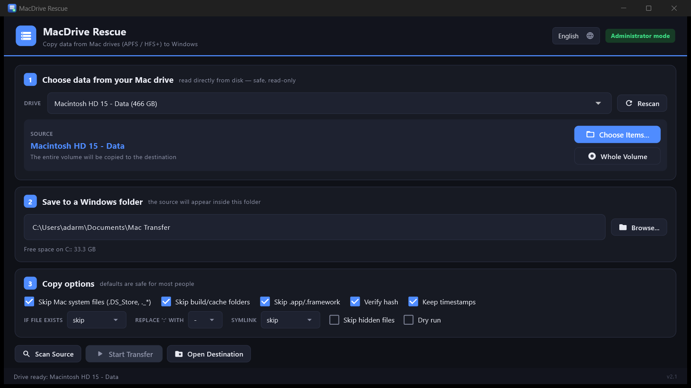
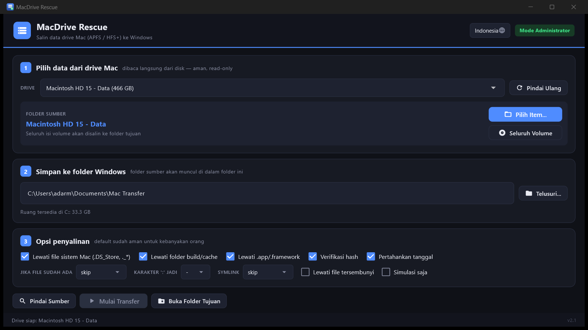

# MacDrive Rescue

**Bahasa:** [English](#english) · [Bahasa Indonesia](#bahasa-indonesia)



Windows app to **copy data from Mac drives (APFS & HFS+) to Windows** — no MacDrive license required.

Built with **Flutter** and **Dart FFI** to native C libraries (libfsapfs, libfshfs). The app reads the physical disk directly (*raw*, read-only), so it keeps working even when the MacDrive trial has expired, is broken, or isn't installed at all.

> Common case: MacDrive is installed but the trial expired — Windows can only "see" folder names on the Mac drive, but **fails to open/copy files** (`A device attached to the system is not functioning` / WinError 31 / Permission denied). This app bypasses that driver entirely.

## Screenshots

| English | Bahasa Indonesia |
|---|---|
|  |  |

## How it works

```
┌─────────────────┐     FFI      ┌──────────────┐    raw I/O    ┌────────────┐
│  Flutter UI     │ ──────────▶  │  macfs.dll   │ ───────────▶  │ Physical   │
│  (Dart)         │              │  (C native)  │               │ DriveN     │
└─────────────────┘              └──────────────┘               └────────────┘
                                        │
                          ┌─────────────┴─────────────┐
                          │ libfsapfs  │  libfshfs    │
                          │  (APFS)    │  (HFS+)      │
                          └────────────┴──────────────┘
```

- **`macfs.dll`** — C bridge statically linking libfsapfs/libfshfs, plus Windows raw disk access and a GPT/MBR parser.
- Flutter UI talks to the DLL via `dart:ffi`.
- All heavy work (scan & copy) runs on **separate isolates** so the UI stays responsive.

## Important: before installing MacDrive

**Do not keep MacDrive installed alongside this app.** When MacDrive 11 is installed it changes
the GPT partition type of your NTFS data drives to "Apple HFS+". After uninstalling MacDrive the
partition type is **not** restored, so those drives lose their letter and become unreadable
(e.g. `GAMES 2` disappearing from Explorer).

**Recovery if it happens** (run in elevated PowerShell):
```powershell
# Restore GPT type to "Basic Data" (adjust DiskNumber/PartitionNumber)
Set-Partition -DiskNumber 1 -PartitionNumber 2 -GptType '{ebd0a0a2-b9e5-4433-87c0-68b6b72699c7}'
# Re-assign drive letter
Set-Partition -DiskNumber 1 -PartitionNumber 2 -NewDriveLetter E
```
Your data is not lost — only the partition metadata is wrong.

## Features

- Auto-detects every APFS/HFS+ volume across all physical disks (including all logical volumes inside an APFS container).
- **Select multiple files AND folders at once** — check several items in the browser; each becomes a top-level entry in the destination.
- Selected folder becomes the destination root — picking `LocalMesh` yields `<dest>\LocalMesh\...` with no `Users\...\Documents\...` chain.
- **Automatic retry (3×)** on read failures (unstable USB), plus a **Retry Failed** button.
- **Mac filename sanitization** for NTFS:
  - `:` → `-` (configurable to `_` or `：`)
  - Illegal chars `< > " | ? *` → `_`
  - Trailing dots/spaces and reserved names (CON, NUL, COM1, …) handled
  - Automatic collision suffixes ` (2)`, ` (3)`, …
  - Unicode NFD → NFC normalization
- Long paths (> 260 chars) supported.
- Preserve timestamps (modified/accessed/created) via Win32 `SetFileTime`.
- Filters Mac system files (`.DS_Store`, `._*`, `.Trashes`, …) and build/cache folders (`build`, `node_modules`, `.dart_tool`, …).
- Symlink handling: skip or follow target.
- Existing-file modes: skip / overwrite / rename.
- **Dry-run** mode.
- Progress bar with speed, ETA, and file position (File N/M).
- **Remembers last settings** (destination, options, last volume, language).
- CSV report (manifest + error list) in a `_laporan` subfolder.
- **Bilingual UI**: English & Bahasa Indonesia (selector in the header).
- **Auto-update**: checks GitHub Releases on startup (silent) and on click of the version
  in the status bar. One click on **Update Now** downloads, installs, and relaunches
  the new version automatically.
- **Unlock encrypted APFS** (FileVault): password prompt for encrypted volumes.
- **Disk info panel**: volume name, filesystem, partition size, encryption status.
- **Auto UAC elevation** — the app requests Administrator on launch (required for raw disk access).

## Requirements

- Windows 10/11 (64-bit)
- **Administrator** rights (required)
- A connected Mac drive (SATA/NVMe internal or USB enclosure)

## Usage

**Option A — single portable exe (easiest):**

1. Download `MacDriveRescue-Portable.exe` from the [Releases page](https://github.com/addrmwn/macdrive-rescue/releases).
2. Double-click it (click **Yes** on the UAC prompt).

**Option B — portable zip:**

1. Download `MacDriveRescue-win64.zip` from the [Releases page](https://github.com/addrmwn/macdrive-rescue/releases).
2. Extract anywhere, run `macdrive_rescue.exe` (click **Yes** on UAC).

**Steps (both options):**

1. Choose the Mac volume from the dropdown (`... - Data` usually holds user data).
2. Click **Choose Items...** to check one or more files/folders, or **Whole Volume**.
3. Choose the Windows destination folder.
4. Adjust options (defaults are safe).
5. Click **Scan Source**, then **Start Transfer**.

## Building the EXE

Flutter produces `macdrive_rescue.exe` in `build\windows\x64\runner\Release\`, but it needs
supporting files beside it (`data\`, `flutter_windows.dll`, `macfs.dll`). For distribution:

- **Portable zip** (simplest):
  ```powershell
  Compress-Archive -Path build/windows/x64/runner/Release/* `
      -DestinationPath MacDriveRescue-win64.zip -Force
  ```
  Users extract the zip and run `macdrive_rescue.exe`.

- **Single portable exe** (self-extracting, auto-run):
  ```powershell
  powershell -ExecutionPolicy Bypass -File native/make_portable.ps1
  ```
  Produces `MacDriveRescue-Portable.exe` (~8 MB): double-click to run — the payload
  extracts to a temp folder automatically. Requires 7-Zip installed (the script
  downloads the official SFX from the LZMA SDK and brands the icon).

## Build from source

### Prerequisites

- [Flutter](https://flutter.dev) 3.27+ (Windows desktop enabled)
- [Visual Studio Build Tools](https://visualstudio.microsoft.com/downloads/) with the C++ workload
- Python 3.10+ (only to download the native library sources)

### Steps

```powershell
# 1. Download native library sources (once)
powershell -ExecutionPolicy Bypass -File native/fetch_sources.ps1

# 2. Build the native DLL (produces native/dist/macfs.dll)
native/build.bat

# 2b. Build the portable launcher (for auto-update support)
native/build_launcher.bat

# 3. Build the Flutter app
flutter pub get
flutter build windows --release

# 4. Copy the DLL next to the exe
Copy-Item native/dist/macfs.dll build/windows/x64/runner/Release/

# 5. Package
Compress-Archive -Path build/windows/x64/runner/Release/* `
    -DestinationPath MacDriveRescue-win64.zip -Force
```

## Project structure

```
lib/
  main.dart                    # entry point
  core/
    macfs_ffi.dart             # Dart FFI bindings to macfs.dll
    partition.dart             # partition info via DLL
    discovery.dart             # Mac volume discovery
    engine.dart                # scan + copy (isolates)
    names.dart                 # Mac -> NTFS filename sanitization
    win_time.dart              # SetFileTime via Win32
    settings.dart              # persisted preferences
    l10n.dart                  # English / Indonesian strings
  ui/
    home_screen.dart           # main screen
    theme.dart                 # dark theme
    widgets.dart               # UI components
native/
  bridge/macfs_bridge.c/.h     # C bridge (compact API for Flutter)
  launcher/launcher.c          # bootstrap: extract-once to %LOCALAPPDATA%
  build_launcher.bat           # build launcher.exe
  shim/libbfio.h               # header shim
  fetch_sources.ps1            # download libfsapfs/libfshfs/zlib sources
  build.bat                    # build the DLL with MSVC
  make_portable.ps1            # create the single-file portable exe
  vendor/                      # (downloaded) library sources + zlib
docs/                          # screenshots
test/
  smoke_dll.dart               # DLL smoke test via Dart FFI
  e2e_engine.dart              # end-to-end scan+copy (needs admin)
  e2e_single_file.dart         # single-file copy test
  e2e_multi.dart               # multi file/folder test
```

## License

App code: [MIT](LICENSE).

Linked native libraries:
- [libfsapfs](https://github.com/libyal/libfsapfs) — LGPL-3.0-or-later
- [libfshfs](https://github.com/libyal/libfshfs) — LGPL-3.0-or-later
- [zlib](https://zlib.net) — zlib license

---

# Bahasa Indonesia


Aplikasi Windows untuk **menyalin data dari drive Mac (APFS & HFS+) ke Windows** — tanpa memerlukan lisensi MacDrive.

Dibangun dengan **Flutter** dan **Dart FFI** ke library native C (libfsapfs, libfshfs). Aplikasi membaca disk fisik secara langsung (*raw*, read-only), sehingga tetap bekerja meskipun driver MacDrive trial sudah kedaluwarsa, rusak, atau tidak terpasang sama sekali.

> Kasus umum: MacDrive terpasang tetapi trial habis — Windows hanya bisa "melihat" nama folder di drive Mac, tetapi **gagal membuka/menyalin file** (error `A device attached to the system is not functioning` / WinError 31 / Permission denied). Aplikasi ini melewati driver tersebut sepenuhnya.

## Screenshot

| Bahasa Indonesia | English |
|---|---|
|  |  |

## Cara kerja

```
┌─────────────────┐     FFI      ┌──────────────┐    raw I/O    ┌────────────┐
│  Flutter UI     │ ──────────▶  │  macfs.dll   │ ───────────▶  │ Physical   │
│  (Dart)         │              │  (C native)  │               │ DriveN     │
└─────────────────┘              └──────────────┘               └────────────┘
                                        │
                          ┌─────────────┴─────────────┐
                          │ libfsapfs  │  libfshfs    │
                          │  (APFS)    │  (HFS+)      │
                          └────────────┴──────────────┘
```

- **`macfs.dll`** — bridge C yang menautkan libfsapfs/libfshfs secara statis, ditambah akses raw disk Windows dan parser GPT/MBR.
- **Flutter UI** berkomunikasi dengan DLL melalui `dart:ffi`.
- Semua operasi berat (scan & copy) berjalan di **isolate terpisah** agar UI tetap responsif.

## Penting: sebelum memasang MacDrive

**Jangan biarkan MacDrive terpasang bersama aplikasi ini.** Saat MacDrive 11 terpasang, ia
mengubah tipe partisi GPT drive data NTFS Anda menjadi "Apple HFS+". Setelah MacDrive
di-uninstall, tipe partisi tersebut **tidak** dikembalikan, sehingga drive kehilangan huruf
dan tidak bisa dibaca (mis. `GAMES 2` hilang dari Explorer).

**Cara memulihkan bila terjadi** (jalankan di PowerShell elevated):
```powershell
# Kembalikan tipe GPT ke "Basic Data" (sesuaikan DiskNumber/PartitionNumber)
Set-Partition -DiskNumber 1 -PartitionNumber 2 -GptType '{ebd0a0a2-b9e5-4433-87c0-68b6b72699c7}'
# Pasang kembali huruf drive
Set-Partition -DiskNumber 1 -PartitionNumber 2 -NewDriveLetter E
```
Data Anda tidak hilang — hanya metadata partisinya yang salah.

## Fitur

- Deteksi otomatis semua volume APFS/HFS+ di seluruh disk fisik (termasuk semua volume logis dalam container APFS).
- **Pilih beberapa file DAN folder sekaligus** — centang beberapa item di browser; masing-masing menjadi entri tingkat atas di folder tujuan.
- Folder yang dipilih menjadi root tujuan — memilih `LocalMesh` menghasilkan `<tujuan>\LocalMesh\...`, tanpa rantai `Users\adidarmawan\Documents\...`.
- **Retry otomatis (3×)** saat pembacaan gagal (USB tidak stabil), plus tombol **Coba Lagi yang Gagal**.
- **Sanitasi nama file** khas Mac untuk NTFS:
  - `:` → `-` (bisa diubah ke `_` atau `：`)
  - Karakter terlarang `< > " | ? *` → `_`
  - Nama berakhir titik/spasi dan nama perangkat cadangan (CON, NUL, COM1, …) ditangani
  - Tabrakan nama otomatis diberi akhiran ` (2)`, ` (3)`, …
  - Normalisasi Unicode NFD → NFC
- **Path panjang** (> 260 karakter) didukung.
- **Pertahankan tanggal** file (modifikasi, akses, pembuatan) via Win32 `SetFileTime`.
- Filter file sistem Mac (`.DS_Store`, `._*`, `.Trashes`, …) dan folder build/cache (`build`, `node_modules`, `.dart_tool`, …).
- Opsi symlink: lewati atau ikuti target.
- Mode jika file sudah ada: lewati / timpa / ganti nama.
- Mode **simulasi** (dry-run).
- Progress bar dengan kecepatan, ETA, dan posisi file (File N/M).
- **Mengingat pengaturan terakhir** (folder tujuan, opsi, volume terakhir, bahasa).
- **Laporan CSV** (manifest + daftar error) di subfolder `_laporan`.
- **UI dwibahasa**: English & Bahasa Indonesia (selector di header).
- **Auto-update**: memeriksa GitHub Releases saat startup (senyap) dan saat versi
  di status bar diklik. Satu klik **Update Sekarang** akan mengunduh, memasang,
  lalu membuka ulang aplikasi dengan versi terbaru secara otomatis.
- **Buka APFS terenkripsi** (FileVault): dialog password untuk volume terenkripsi.
- **Panel info disk**: nama volume, filesystem, ukuran partisi, status enkripsi.
- **Auto-elevasi UAC** — aplikasi meminta hak Administrator saat dijalankan (wajib untuk akses raw disk).

## Persyaratan

- Windows 10/11 (64-bit)
- Hak **Administrator** (wajib)
- Drive Mac terpasang (SATA/NVMe internal atau USB enclosure)

## Cara pakai

**Opsi A — satu file portable exe (termudah):**

1. Unduh `MacDriveRescue-Portable.exe` dari [halaman Releases](https://github.com/addrmwn/macdrive-rescue/releases).
2. Double-click file tersebut (klik **Yes** pada prompt UAC).

**Opsi B — zip portable:**

1. Unduh `MacDriveRescue-win64.zip` dari [halaman Releases](https://github.com/addrmwn/macdrive-rescue/releases).
2. Ekstrak ke folder mana pun, jalankan `macdrive_rescue.exe` (klik **Yes** pada UAC).

**Langkah pemakaian (sama untuk kedua opsi):**

1. Pilih volume Mac pada dropdown (volume `… - Data` biasanya berisi data pengguna).
2. Klik **Pilih Item...** untuk mencentang satu atau beberapa file/folder, atau **Seluruh Volume**.
3. Pilih folder tujuan Windows.
4. Atur opsi (default sudah aman).
5. Klik **Pindai Sumber**, lalu **Mulai Transfer**.

## Membuat file EXE

Flutter menghasilkan `macdrive_rescue.exe` di `build\windows\x64\runner\Release\`,
tetapi exe itu membutuhkan file pendukung di sebelahnya (`data\`,
`flutter_windows.dll`, `macfs.dll`). Untuk distribusi:

- **Zip portable** (cara paling sederhana):
  ```powershell
  Compress-Archive -Path build/windows/x64/runner/Release/* `
      -DestinationPath MacDriveRescue-win64.zip -Force
  ```
  Pengguna mengekstrak zip lalu menjalankan `macdrive_rescue.exe`.

- **Satu file exe tunggal** (self-extracting, auto-run):
  ```powershell
  powershell -ExecutionPolicy Bypass -File native/make_portable.ps1
  ```
  Menghasilkan `MacDriveRescue-Portable.exe` (~8 MB): double-click langsung
  jalan — payload diekstrak ke folder temp secara otomatis. Membutuhkan
  7-Zip terpasang (script mengunduh SFX resmi dari LZMA SDK dan memasang icon).

## Build dari source

### Prasyarat

- [Flutter](https://flutter.dev) 3.27+ (Windows desktop enabled)
- [Visual Studio Build Tools](https://visualstudio.microsoft.com/downloads/) dengan C++ workload
- Python 3.10+ (hanya untuk mengunduh source library)

### Langkah

```powershell
# 1. Unduh source library native (sekali saja)
powershell -ExecutionPolicy Bypass -File native/fetch_sources.ps1

# 2. Build DLL native (menghasilkan native/dist/macfs.dll)
native/build.bat

# 2b. Build launcher portable (untuk dukungan auto-update)
native/build_launcher.bat

# 3. Build aplikasi Flutter
flutter pub get
flutter build windows --release

# 4. Salin DLL ke folder rilis
Copy-Item native/dist/macfs.dll build/windows/x64/runner/Release/

# 5. Buat paket zip
Compress-Archive -Path build/windows/x64/runner/Release/* `
    -DestinationPath MacDriveRescue-win64.zip -Force
```

## Struktur proyek

```
lib/
  main.dart                    # entry point
  core/
    macfs_ffi.dart             # binding Dart FFI ke macfs.dll
    partition.dart             # info partisi via DLL
    discovery.dart             # deteksi volume Mac
    engine.dart                # scan + copy (isolate)
    names.dart                 # sanitasi nama Mac -> NTFS
    win_time.dart              # SetFileTime via Win32
    settings.dart              # pengaturan tersimpan
    l10n.dart                  # string English / Indonesia
  ui/
    home_screen.dart           # layar utama
    theme.dart                 # tema gelap
    widgets.dart               # komponen UI
native/
  bridge/macfs_bridge.c/.h     # bridge C (API ringkas untuk Flutter)
  launcher/launcher.c          # bootstrap: ekstrak sekali ke %LOCALAPPDATA%
  build_launcher.bat           # build launcher.exe
  shim/libbfio.h               # shim header
  fetch_sources.ps1            # unduh source libfsapfs/libfshfs/zlib
  build.bat                    # build DLL dengan MSVC
  make_portable.ps1            # buat exe portable satu file
  vendor/                      # (diunduh) source library + zlib
docs/                          # screenshot
test/
  smoke_dll.dart               # uji DLL via Dart FFI
  e2e_engine.dart              # uji end-to-end scan+copy (butuh admin)
  e2e_single_file.dart         # uji salin file tunggal
  e2e_multi.dart               # uji multi file/folder
```

## Lisensi

Kode aplikasi: [MIT](LICENSE).

Library native yang ditautkan:
- [libfsapfs](https://github.com/libyal/libfsapfs) — LGPL-3.0-or-later
- [libfshfs](https://github.com/libyal/libfshfs) — LGPL-3.0-or-later
- [zlib](https://zlib.net) — zlib license